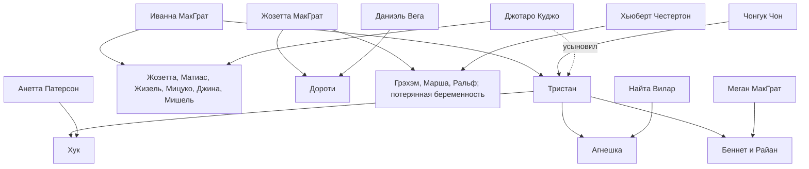

[[00 Главная|На главную]] · [[01 Реестр персонажей|01 Реестр персонажей]]

## Главные ветви

Схема показывает происхождение; полные браки и имена находятся в кликабельных таблицах ниже. Группа из шести детей раскрывается в реестре II поколения.

## Родитель → ребёнок

| Родитель | Ребёнок | Связь |
| --- | --- | --- |
| [[Персонажи/Иванна МакГрат\|Иванна МакГрат]] | [[Персонажи/Тристан МакГрат\|Тристан МакГрат]] | Биологический родитель |
| [[Персонажи/Иванна МакГрат\|Иванна МакГрат]] | [[Персонажи/Жозетта МакГрат\|Жозетта МакГрат]] | Биологический родитель |
| [[Персонажи/Иванна МакГрат\|Иванна МакГрат]] | [[Персонажи/Матиас МакГрат\|Матиас МакГрат]] | Биологический родитель |
| [[Персонажи/Иванна МакГрат\|Иванна МакГрат]] | [[Персонажи/Жизель МакГрат\|Жизель МакГрат]] | Биологический родитель |
| [[Персонажи/Иванна МакГрат\|Иванна МакГрат]] | [[Персонажи/Мицуко МакГрат\|Мицуко МакГрат]] | Биологический родитель |
| [[Персонажи/Иванна МакГрат\|Иванна МакГрат]] | [[Персонажи/Джина МакГрат\|Джина МакГрат]] | Биологический родитель |
| [[Персонажи/Иванна МакГрат\|Иванна МакГрат]] | [[Персонажи/Мишель МакГрат\|Мишель МакГрат]] | Биологический родитель |
| [[Персонажи/Чонгук Чон\|Чонгук Чон]] | [[Персонажи/Тристан МакГрат\|Тристан МакГрат]] | Биологический родитель |
| [[Персонажи/Джотаро Куджо\|Джотаро Куджо]] | [[Персонажи/Жозетта МакГрат\|Жозетта МакГрат]] | Биологический родитель |
| [[Персонажи/Джотаро Куджо\|Джотаро Куджо]] | [[Персонажи/Матиас МакГрат\|Матиас МакГрат]] | Биологический родитель |
| [[Персонажи/Джотаро Куджо\|Джотаро Куджо]] | [[Персонажи/Жизель МакГрат\|Жизель МакГрат]] | Биологический родитель |
| [[Персонажи/Джотаро Куджо\|Джотаро Куджо]] | [[Персонажи/Мицуко МакГрат\|Мицуко МакГрат]] | Биологический родитель |
| [[Персонажи/Джотаро Куджо\|Джотаро Куджо]] | [[Персонажи/Джина МакГрат\|Джина МакГрат]] | Биологический родитель |
| [[Персонажи/Джотаро Куджо\|Джотаро Куджо]] | [[Персонажи/Мишель МакГрат\|Мишель МакГрат]] | Биологический родитель |
| [[Персонажи/Тристан МакГрат\|Тристан МакГрат]] | [[Персонажи/Хук Патерсон\|Хук Патерсон]] | Биологический родитель |
| [[Персонажи/Тристан МакГрат\|Тристан МакГрат]] | [[Персонажи/Агнешка Вилар\|Агнешка Вилар]] | Биологический родитель |
| [[Персонажи/Тристан МакГрат\|Тристан МакГрат]] | [[Персонажи/Беннет МакГрат\|Беннет МакГрат]] | Биологический родитель |
| [[Персонажи/Тристан МакГрат\|Тристан МакГрат]] | [[Персонажи/Райан МакГрат\|Райан МакГрат]] | Биологический родитель |
| [[Персонажи/Жозетта МакГрат\|Жозетта МакГрат]] | [[Персонажи/Дороти МакГрат\|Дороти МакГрат]] | Биологический родитель |
| [[Персонажи/Жозетта МакГрат\|Жозетта МакГрат]] | [[Персонажи/Грэхэм МакГрат\|Грэхэм МакГрат]] | Биологический родитель |
| [[Персонажи/Жозетта МакГрат\|Жозетта МакГрат]] | [[Персонажи/Марша МакГрат\|Марша МакГрат]] | Биологический родитель |
| [[Персонажи/Жозетта МакГрат\|Жозетта МакГрат]] | [[Персонажи/Ральф МакГрат\|Ральф МакГрат]] | Биологический родитель |
| [[Персонажи/Жозетта МакГрат\|Жозетта МакГрат]] | [[Персонажи/Нерождённый ребёнок Жозетты и Хьюберта\|Нерождённый ребёнок Жозетты и Хьюберта]] | Биологический родитель |
| [[Персонажи/Даниэль Вега\|Даниэль Вега]] | [[Персонажи/Дороти МакГрат\|Дороти МакГрат]] | Биологический родитель |
| [[Персонажи/Хьюберт Честертон\|Хьюберт Честертон]] | [[Персонажи/Грэхэм МакГрат\|Грэхэм МакГрат]] | Биологический родитель |
| [[Персонажи/Хьюберт Честертон\|Хьюберт Честертон]] | [[Персонажи/Марша МакГрат\|Марша МакГрат]] | Биологический родитель |
| [[Персонажи/Хьюберт Честертон\|Хьюберт Честертон]] | [[Персонажи/Ральф МакГрат\|Ральф МакГрат]] | Биологический родитель |
| [[Персонажи/Хьюберт Честертон\|Хьюберт Честертон]] | [[Персонажи/Нерождённый ребёнок Жозетты и Хьюберта\|Нерождённый ребёнок Жозетты и Хьюберта]] | Биологический родитель |
| [[Персонажи/Меган МакГрат\|Меган МакГрат]] | [[Персонажи/Беннет МакГрат\|Беннет МакГрат]] | Биологический родитель |
| [[Персонажи/Меган МакГрат\|Меган МакГрат]] | [[Персонажи/Райан МакГрат\|Райан МакГрат]] | Биологический родитель |
| [[Персонажи/Анетта Патерсон\|Анетта Патерсон]] | [[Персонажи/Хук Патерсон\|Хук Патерсон]] | Биологический родитель |
| [[Персонажи/Анетта Патерсон\|Анетта Патерсон]] | [[Персонажи/Рэнди Тернбулл\|Рэнди Тернбулл]] | Биологический родитель |
| [[Персонажи/Анетта Патерсон\|Анетта Патерсон]] | [[Персонажи/Клей Штельмахер\|Клей Штельмахер]] | Биологический родитель |
| [[Персонажи/Найта Вилар\|Найта Вилар]] | [[Персонажи/Агнешка Вилар\|Агнешка Вилар]] | Биологический родитель |
| [[Персонажи/Джотаро Куджо\|Джотаро Куджо]] | [[Персонажи/Тристан МакГрат\|Тристан МакГрат]] | Усыновление |
| [[Персонажи/Хьюберт Честертон\|Хьюберт Честертон]] | [[Персонажи/Дороти МакГрат\|Дороти МакГрат]] | Отчим; усыновление не подтверждено |

## Браки и партнёры

| Персонаж | Связи |
| --- | --- |
| [[Персонажи/Иванна МакГрат\|Иванна МакГрат]] | [[Персонажи/Чонгук Чон\|Чонгук Чон]] — первый муж; развод [[Персонажи/Джотаро Куджо\|Джотаро Куджо]] — второй муж; овдовела [[Персонажи/Уилл Тиллер\|Уилл Тиллер]] — третий муж; брак до её смерти |
| [[Персонажи/Чонгук Чон\|Чонгук Чон]] | [[Персонажи/Иванна МакГрат\|Иванна МакГрат]] — развелись |
| [[Персонажи/Джотаро Куджо\|Джотаро Куджо]] | [[Персонажи/Иванна МакГрат\|Иванна МакГрат]] — второй муж |
| [[Персонажи/Уилл Тиллер\|Уилл Тиллер]] | [[Персонажи/Иванна МакГрат\|Иванна МакГрат]] — вдовец |
| [[Персонажи/Тристан МакГрат\|Тристан МакГрат]] | [[Персонажи/Меган МакГрат\|Меган МакГрат]] — жена [[Персонажи/Анетта Патерсон\|Анетта Патерсон]] — случайная связь; мать Хука [[Персонажи/Найта Вилар\|Найта Вилар]] — случайная связь; мать Агнешки [[Персонажи/Кассандра Гот\|Кассандра Гот]] — бывшая партнёрша по древу |
| [[Персонажи/Жозетта МакГрат\|Жозетта МакГрат]] | [[Персонажи/Даниэль Вега\|Даниэль Вега]] — первый муж; погиб [[Персонажи/Хьюберт Честертон\|Хьюберт Честертон]] — второй муж [[Персонажи/Оранж Бейли-Мун\|Оранж Бейли-Мун]] — бывший жених [[Персонажи/Макс Виллареаль\|Макс Виллареаль]] — бывший партнёр |
| [[Персонажи/Даниэль Вега\|Даниэль Вега]] | [[Персонажи/Жозетта МакГрат\|Жозетта МакГрат]] — муж до своей гибели |
| [[Персонажи/Хьюберт Честертон\|Хьюберт Честертон]] | [[Персонажи/Жозетта МакГрат\|Жозетта МакГрат]] — жена |
| [[Персонажи/Меган МакГрат\|Меган МакГрат]] | [[Персонажи/Тристан МакГрат\|Тристан МакГрат]] — муж |
| [[Персонажи/Анетта Патерсон\|Анетта Патерсон]] | [[Персонажи/Тристан МакГрат\|Тристан МакГрат]] — случайная связь [[Персонажи/Криспин Блэк\|Криспин Блэк]] — позднейший муж; умер [[Персонажи/Тодор Штельмахер\|Тодор Штельмахер]] — последний известный муж |
| [[Персонажи/Найта Вилар\|Найта Вилар]] | [[Персонажи/Тристан МакГрат\|Тристан МакГрат]] — случайная связь |
| [[Персонажи/Дороти МакГрат\|Дороти МакГрат]] | [[Персонажи/Ник Хайд\|Ник Хайд]] — связь не завершена; разрыв не проговорён [[Персонажи/Джош Вудланд\|Джош Вудланд]] — интрижка [[Персонажи/Тиагу Абрантеш\|Тиагу Абрантеш]] — интрижка |
| [[Персонажи/Грэхэм МакГрат\|Грэхэм МакГрат]] | [[Персонажи/Изабелла Уотерс\|Изабелла Уотерс]] — бывшая партнёрша по древу [[Персонажи/София Абрантеш\|София Абрантеш]] — бывшая партнёрша по древу |

Полные братья и сёстры и общие родители перечислены в каждой личной карточке. Четверо детей Дженкинов и трое детей Бьянки находятся в окружении, а не включаются автоматически в поколения МакГратов.
