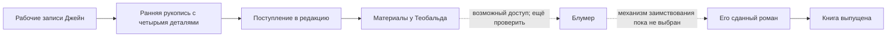

[[09 Все совпадения случайны|Навигатор арки]] · [[00 Главная|Главная вики]]

**Главное различие:** автор знает будущую конструкцию, а Дороти и Дрейк в [[Арки/Все совпадения случайны/Посты/P28 Начинается расследование|28 Начинается расследование?]] знают только тексты и возможность доступа. Основание набора улик — [[Арки/Все совпадения случайны/Источники/S01 арка издательство#S01-M024|арка издательство · 13, автор]] и [[Арки/Все совпадения случайны/Источники/S02 Арка издательство бранч#S02-M044|Арка издательство бранч · 23, автор]].

| Деталь | Уже доступно героям | Авторский план проверки | Сила и предел |
| --- | --- | --- | --- |
| Пансион, море, письма, дождь, маяк | Сходные мотивы обоих романов. | Место и местные легенды существуют. | Общий жанровый материал; слабая улика сам по себе. |
| Третий крючок | Совпадающий образ в текстах. | Джейн придумала крючок как место отсутствующего человека. | След художественного отбора; сегодняшнее отсутствие крючка не доказывает, что его не было прежде. Нужны ранние заметки/свидетельство, а не один осмотр стены. |
| Синий дождевик | Повторяется цвет и его связь с ожиданием. | Синий цвет — решение Джейн. | Усиливает совпадение комплекса. Зелёный реальный плащ и точное число реальных крючков пока варианты, не утверждённые факты. |
| Банка из-под печенья с собакой | Банка известна из текстов; рисунок собаки закреплён в разработке. | Джейн видела частную вещь у хозяйки, Блумер с хозяйкой не говорил. | Проверять не только личный визит Блумера, но и фото, пересказы, доступность предмета другим людям. «Не помнит» слабее «точно не показывала». |
| 1908 вместо 1906 | 1908 фигурирует в совпадающем наборе; пока не установлено, что это ошибка. | Один и тот же пожар документирован 1906 годом; Джейн ошиблась, Блумер повторил. | Сильный след передачи версии, если исключён общий неверный источник. Одна ошибка не устанавливает направление копирования. |
| Раннее поступление Джейн | Дороти читала её раньше визита и сдачи Блумера. | Поднять записи поступления, письма, датированные экземпляры. | Доказывает приоритет конкретной версии, но не автоматически приоритет всех идей. |
| Визит Блумера | Он мог видеть материалы у Теобальда. | Установить состав папки, время и способ доступа. | Возможность, не факт чтения. |
| Месяц до сдачи Блумера | Зафиксирован в постах. | Сравнить ранний вариант его романа и поздние вставки — если такая версия будет введена автором. | Срок подозрителен лишь в контексте объёма переработки. Сам по себе ничего не доказывает. |

## Две собаки, которые нельзя смешивать

В опубликованном первом абзаце «Третьего крючка» **живой старый пёс спит под столом во время дождя**. **Изображение собаки на жестяной банке** — отдельная деталь расследовательского плана. Отсутствие рисунка в первом абзаце не означает его отсутствия во всём романе, но и не позволяет объявить его уже показанной читателю уликой. Перед решающей проверкой рисунок нужно предъявить в обоих текстах.

## Минимальная цепочка доступа

**Редакторское предложение для ясности:** выбрать один основной путь — чтение полной распечатки, получение файла или подробная аннотация. Если в аннотации только общие мотивы и нет собаки/ошибки/формулировок, она не объясняет весь набор совпадений. Нельзя добавлять задним числом удобный канал, не показав, откуда герои о нём узнали.

## Как закрыть вопрос с датой без логического скачка

1. До поездки Джейн показывает рабочую запись. Вариант «1908?» удобен, но знак вопроса пока принадлежит предложенной сцене, а не опубликованному доказательству.
2. В архиве герои удостоверяются, что запись 1906 относится именно к этому пожару. Дата печати газетного номера и дата события могут различаться.
3. Выясняют, откуда взялось 1908. Предлагались нечитаемая цифра, ошибка на слух и смешение двух дат; единственная причина пока не выбрана.
4. Проверяют, не циркулирует ли 1908 в доступной всем вырезке или местной легенде. Если циркулирует, эта улика слабее, её нельзя подавать решающей.
5. Соединяют ошибку с двумя выдуманными деталями, частной банкой, приоритетом версии и доступом.

Пункты 2–5 — **редакторская проверка логики**, а не новые совершившиеся события. Формула старого обсуждения «сам исследовал бы — обязательно нашёл бы 1906» чрезмерна: независимый исследователь тоже способен ошибиться. Исходное рассуждение сохранено: [[Арки/Все совпадения случайны/Источники/S02 Арка издательство бранч#S02-M045|Арка издательство бранч · 23, обсуждение]].

## Контроль знания на последнем посте

| Персонаж | Установлено | Ещё нельзя ему приписывать |
| --- | --- | --- |
| Дороти | Сходство текстов, порядок собственного чтения, возможность доступа, существование пансиона. | Верную дату 1906, признание Джейн о выдумках, подтверждённую вину Блумера. |
| Дрейк | Ознакомился с сопоставлением и принимает сходство всерьёз; формулирует метод. | Готовое знание, кто украл и как. |
| Ким | Замечает два романа о письмах. | Участие в тайном расследовании целиком. |
| Теобальд | Получил обе рукописи, руководит выпуском; знает, что снял собственный фактчек. | Знание о плагиате до предъявления результатов. |
| Венла | Возражала против отказа от проверки. | Знание тайны пожара через вампирский возраст. |
| Люция | Знает рабочий оборот и Ванессу. | Всеведение о копировании. Ранняя подсказка о прежних похожих случаях — только вариант. |

См. также [[04 Кто что знает|04 Кто что знает]].

## Дополнительный материал для обдумывания

[[Арки/Все совпадения случайны/13 Логика расследования и взаимное узнавание — материал для обдумывания|Разбор логики расследования, незакрытых линий и взаимного узнавания Дороти и Дрейка]] — редакторские рассуждения и варианты сцен для авторской оценки; **не канон и не утверждённый план**.
